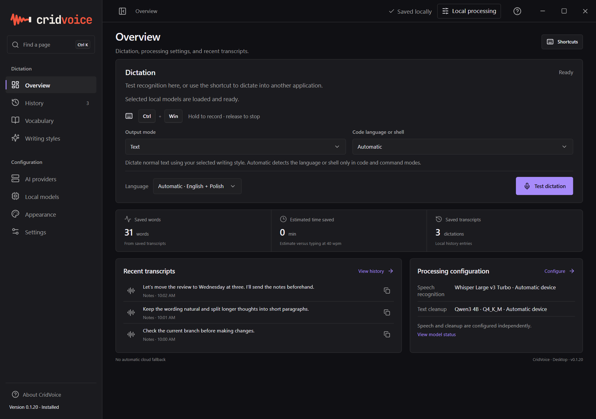
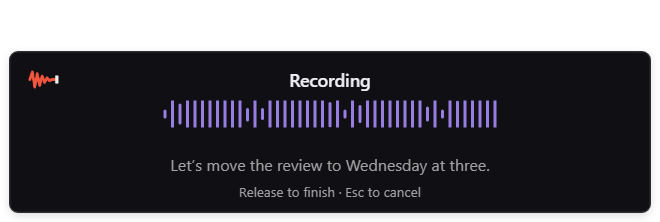
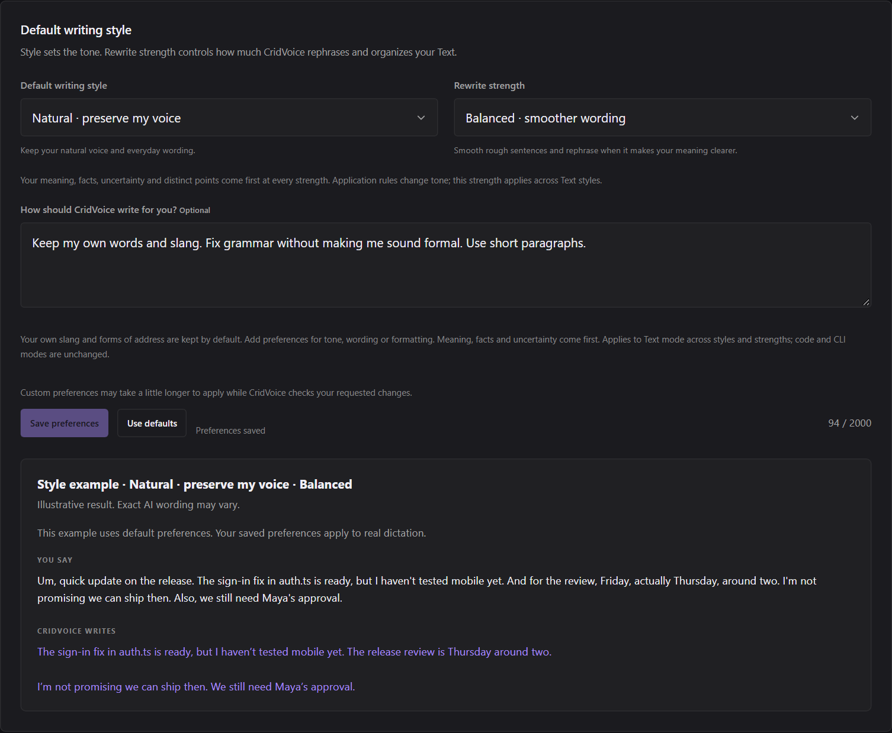

<picture>
  <source media="(prefers-color-scheme: dark)" srcset="src/assets/branding/lockup-dark.png">
  
</picture>

### Voice dictation that still sounds like you.

Messages, notes, emails, code, and the thoughts you haven't organized yet. 
Say what you mean. Let CridVoice help put it into words.

**Windows 11 x64 · English + Polish · Local AI or your chosen provider**

[Download for Windows](https://github.com/chriszoladz/CridVoice/releases/tag/v0.1.20) · [See the app](#a-look-inside) · [Get started](#getting-started) · [User guide](docs/USER-GUIDE.md)

---

## Speak. Release. Keep going.

CridVoice turns your speech into text in the app you're using. Write a quick reply, get a longer thought down, or dictate code and commands without switching back and forth to a separate editor.

Click a text field, hold <kbd>Ctrl</kbd> + <kbd>Windows</kbd>, and speak. Release the keys to finish. CridVoice transcribes your words and inserts the result into the field.

A compact popup shows the waveform and live text while you talk. Preview words can change as you keep speaking.

## A look inside

**Your workspace.** Dictation controls, recent transcripts, and your processing choices in one place.

**Your words as you speak.** The recording popup stays compact so you can keep your attention on what you're writing.

  

<strong>See writing styles and personal preferences</strong>

Choose a tone, adjust how much rewriting happens, and tell CridVoice how you want to sound.

Screenshots show CridVoice 0.1.20 with sample text.

## Make it work your way

| Feature | What you can do |
| --- | --- |
| **Everyday dictation** | Speak into messages, notes, email, and other text fields. |
| **Clearer writing** | Clean up grammar and rough thoughts, with Light, Balanced, or Thorough rewriting. |
| **Your own voice** | Choose a writing style and add preferences for your slang, tone, and formatting. |
| **Code and commands** | Dictate code literally or generate it from spoken instructions. Detect the language or shell automatically, or choose it yourself. |
| **English and Polish** | Use automatic language detection or select a language manually. |
| **Vocabulary and app rules** | Prioritize names and spellings, and choose different writing styles for different apps. |
| **Local or cloud AI** | Run speech recognition and text cleanup on your PC, or connect a compatible provider. |
| **Searchable history** | Find, copy, export, or delete saved transcripts. Saving history is optional. |
| **Background audio control** | Temporarily lower music and video playback while speaking, with an adjustable reduction slider. |
| **A workspace that fits** | Change the theme and text size, collapse the sidebar, and set shortcuts by pressing the keys. |

## Keep it sounding like you

Want grammar fixes without sounding formal? Prefer short paragraphs? Want to keep your own slang? Tell CridVoice in **Writing styles → How should CridVoice write for you?**

> Keep my own words and slang. Fix grammar without making me sound formal. Use short paragraphs.

Choose **Save preferences**, then use **Light**, **Balanced**, or **Thorough** to control how much rewriting happens. Your intended meaning, facts, and uncertainty come first. Review important details before sending.

Writing preferences apply to normal text. Coding modes handle code and commands separately; generated code opens for review and copying.

## Getting started

**[Download CridVoice 0.1.20](https://github.com/chriszoladz/CridVoice/releases/tag/v0.1.20)** for Windows 11 x64.

| Install it | Keep it portable |
| --- | --- |
| [Windows installer](https://github.com/chriszoladz/CridVoice/releases/download/v0.1.20/CridVoice-0.1.20-windows-x64-setup.exe) | [Portable ZIP](https://github.com/chriszoladz/CridVoice/releases/download/v0.1.20/CridVoice-0.1.20-windows-x64-portable.zip) |

Run the installer, or extract the entire portable ZIP and open `CridVoice.exe`. Keep the portable files together. The current download is an unsigned prerelease.

The setup wizard guides you through language, AI processing, and preferences. Choose local AI or connect a provider. Required local models download during setup with visible progress.

Finish setup, click a text field, and try <kbd>Ctrl</kbd> + <kbd>Windows</kbd>. You can revisit setup and change your choices in Settings.

Local AI can use your CPU or a supported NVIDIA GPU. See [models and hardware](docs/MODELS.md) if you're choosing a setup for your PC.

## Shortcuts

| Shortcut | Action |
| --- | --- |
| <kbd>Ctrl</kbd> + <kbd>Windows</kbd> | Hold to dictate; release to finish |
| <kbd>Ctrl</kbd> + <kbd>Shift</kbd> + <kbd>Space</kbd> | Start or stop dictation |
| <kbd>Ctrl</kbd> + <kbd>Alt</kbd> + <kbd>R</kbd> | Rewrite selected text using spoken instructions |
| <kbd>Escape</kbd> | Cancel |

To change a shortcut, select **Change** in Settings and press the combination you want.

## Your words, your choice

With local AI selected for both speech and cleanup, your audio and text are processed on your PC. If you choose a cloud provider, the information needed for that step is sent to that provider.

You control whether transcripts are saved. You can also enable clipboard copying for completed dictation in Settings. Read [Privacy and storage](docs/PRIVACY.md) for details.

## Need a hand?

[User guide](docs/USER-GUIDE.md) · [Troubleshooting](docs/TROUBLESHOOTING.md) · [Polski: szybki start](docs/QUICKSTART-PL.md) · [What's new](CHANGELOG.md)

For contributors: [development guide](docs/DEVELOPMENT.md). Third-party components retain their own [licenses and notices](THIRD-PARTY-NOTICES.md).
