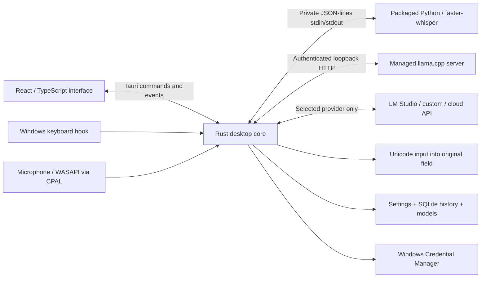

# Architecture

## Components



There is no hosted CridVoice backend. Rust is the local application backend. React does not make inference/provider HTTP requests and never receives stored API keys. User-entered draft keys are passed to explicit native save/test/discovery operations; saved values are not returned. CSP blocks external scripts and direct provider network calls from the webview.

## Source map

| File | Responsibility |
| --- | --- |
| `src/App.tsx` | Shell, overview, state, events, settings persistence, overlay |
| `src/Onboarding.tsx` | Setup/repair routing, required downloads, and final readiness |
| `src/panels.tsx` | History, provider, model, vocabulary, style, theme, settings controls |
| `src/CodingControls.tsx` | Shared output-mode and Auto/manual language or shell controls |
| `src/ProviderModelPicker.tsx` | Explicit shared model-ID fetch, custom fallback, and stale-request guards |
| `src/ShortcutRecorder.tsx` | Temporary chord capture, conflict feedback, and deliberate save/reset |
| `src/BackgroundAudioControl.tsx` | Optional playback reduction, local slider draft and deliberate percentage commits |
| `src/ApplicationStyleEditor.tsx` | Common/recent/running/custom application-name choices |
| `src/WindowTitlebar.tsx` | Main-window drag/maximize and accessible caption controls |
| `src/bridge.ts` | Typed Tauri bridge and explicit browser preview |
| `src/setupPlan.ts` | Complete selected local asset plan and frontend provider readiness |
| `src-tauri/src/desktop.rs` | Lifecycle, Tauri commands, tray, session controller |
| `src-tauri/src/controller.rs` | Ordered recording actions and cancellation dispatch |
| `src-tauri/src/native.rs` | Keyboard hook, UI Automation, input, child-process job |
| `src-tauri/src/shortcut_capture.rs` | Bounded capture lease, injected-input exclusion, and key ownership |
| `src-tauri/src/discovery.rs` | Bounded provider model listing and visible-window process basenames |
| `src-tauri/src/clipboard.rs` | Owned clipboard backup, temporary paste, privacy markers, restoration |
| `src-tauri/src/audio.rs` | Microphone worker, PCM buffers, resampling, WAV snapshots |
| `src-tauri/src/ducking.rs` | Optional recording-scoped playback reduction and restoration on a dedicated COM worker |
| `src-tauri/src/inference.rs` | Speech RPC, managed LLM startup, cloud speech, credentials |
| `src-tauri/src/warmup.rs` | Selected local model routes and cancellable background preparation tickets |
| `src-tauri/src/diagnostics.rs` | Concurrent child-pipe draining and fixed diagnostic categories |
| `src-tauri/src/core.rs` | Endpoint validation, shortcut parsing, prompts, provider responses |
| `src-tauri/src/coding.rs` | Technical-mode language hints, prompts, fenced output and bounded CLI normalization |
| `src-tauri/src/downloads.rs` | Verified/resumable downloads and safe runtime extraction |
| `src-tauri/src/setup.rs` | Native selected-asset/provider readiness before setup completion |
| `src-tauri/src/config.rs` | Defaults, serialized settings, validation |
| `src-tauri/src/store.rs` | SQLite history and atomic JSON writes |
| `src-tauri/src/vault.rs` | User-scoped DPAPI encryption and encrypted Credential Manager records |
| `src-tauri/resources/service/speech.py` | Python speech worker, GPU DLL search, offline models |

## Recording and state

When `general.duckBackgroundAudio` is enabled, a recorder-owned guard queues per-session playback reduction on a dedicated Windows MTA thread. Stop/cancel/Drop invalidates the take token and queues restoration without waiting in the final-recognition path. Session-created notifications discover new sessions on the existing active outputs; there is no polling loop. Sessions belonging to CridVoice and system sounds are excluded. The guard restores only an unchanged scalar that it applied, and volume-change notifications retain user adjustments. Normal tray exit allows a bounded restoration wait.

History's inner view is memoized separately from session/audio events. Filtering is cached by history, language and query; an empty query skips transcript-string normalization. Integer-format microphone callbacks convert samples while downmixing rather than allocating an intermediate normalized buffer. The final resampler and recognition settings are unchanged.

Background local-model preparation uses a separate warm-up epoch from recording sessions. Final speech, CPU preview, and cleanup prepare behind their individual engine locks, using only installed selected app-managed routes. Queued work rechecks its ticket before starting; route changes, explicit unload, maintenance, and shutdown invalidate stale preparation. Warm-up does not capture audio or application context, use history or provider credentials, or make external-provider calls. Its engine-status events leave the recording session idle and keep recording available.

Speech preparation validates the selected model/device, shares the transcription cache, initializes lazy ONNX VAD with one second of internal zero audio, and consumes a bounded encoder/decoder pass. Its generated result is discarded and never saved. Managed cleanup starts the selected loopback server and completes a tiny representative prompt using public defaults and the current output mode only. Loaded status follows completion of these warm requests; queuing a request alone does not establish readiness. A cancelled warm request retires its worker while still holding the engine lock before maintenance can proceed. Explicit unload suspends automatic preparation until deliberate loading/use, a selected-route change, or restart.

Idle → Recording → Transcribing → Cleaning → Inserting → Idle, with error/cancel paths. Recording is created on a dedicated thread so CPAL stream ownership is independent of the async executor. Input channels are averaged into mono, and a windowed-sinc resampler produces 16 kHz signed 16-bit WAV data.

The controller snapshots the focused application/selection and tracks a generation number. Cancelling increments the generation; obsolete preview/final results cannot insert text. A lifecycle lock and ordered action queue serialize recording transitions. Cancellation can invalidate a pending result without waiting for model inference. Local preview uses its own low-priority two-thread `--preview-worker` Python process and mutex, fixed to `whisper-preview`/CPU. One request at a time processes at most the latest six seconds, with a first opportunity around 750 ms and a minimum 300 ms start interval; busy opportunities do not queue. Preview replies replace the provisional recent-speech string, including corrections and shorter revisions. Recording generation and active-take checks discard stale results. After a successful send, the dedicated lane drains its reply so it cannot poison the next request. Final full-audio recognition uses the independently warm selected speech engine and its original decoding options; it does not wait for the preview mutex. Remote preview preserves its original provider/cadence. Microphone metering continues to emit regular session events. Audio limits bound memory and file sizes.

The preview path is greedy, skips word/timestamp output and prior-window conditioning, and caps each preview decode at 64 new tokens. It does not provide a true per-word callback. The UI shows the latest two lines in a fixed popup without animation, retains all current-window text in the accessible DOM, and avoids per-word live announcements. Overview follows text changes while near the bottom, not meter events, and preserves manual reading position. Neither surface stitches rolling hypotheses into a final transcript.

The recording bar labels the current stage as Recording, Transcribing, Cleaning, or Inserting and shows Escape cancellation during processing. These labels describe application progress, rather than establishing that a model or target application has succeeded.

The low-level Windows keyboard hook tracks left/right modifier keys. It ignores injected downs and ordinary injected keys; injected modifier ups can clear state or stop, but never start a shortcut. Before each physical event it clears other stale cached modifiers using Windows async state, without adopting async downs or checking the current key before Windows updates it. Suppressed Windows downs retain ownership through repeats and their eventual physical up; when a hold ends, they require that up and a fresh down to rearm. Forwarded Windows downs keep their releases forwarded. Physical shortcut-related downs alone can start actions, and work is dispatched out of the hook callback. Modifier-only Ctrl+Windows is supported directly; ordinary global shortcut libraries cannot represent that chord consistently.

## Context and insertion

A dedicated MTA worker retains its UI Automation client and the most recent original editor provider rather than recreating the COM apartment on every probe. Requests have a 500 ms response timeout, a single queued slot and expiry checks; UIA connection/transaction timeouts also bound ordinary provider calls. Text fragments normalize only to the nearest actual editable host, and its native ancestor must belong to the captured foreground window. Ordinary field matching remains exact. A recreated field is accepted only if the retained original explicitly reports UIA_E_ELEMENTNOTAVAILABLE and both captures prove the same unique AutomationId, parent runtime ID, process and editor control type. Same window, similar text, geometry or a matching name are insufficient. Focus metadata is ephemeral and skipped during serialization.

Optional completed-result clipboard copying happens after temporary paste returns/restores and under the final lifecycle/generation lock. It deliberately replaces previous clipboard contents only for completed non-review dictation with successful cleanup, including a failed insertion attempt. It sends no keystrokes and never retries insertion. Preparation allocates all payload handles before EmptyClipboard, publishes privacy markers before Unicode text and transfers ownership only after each successful Windows call. Cancellation/stale takes cannot publish through the final commit.

Ordinary Text and literal code cleanup exclude selected/nearby text from the model payload. Code-language detection still derives hints locally from permitted context. Explicit rewrites and generation can use their permitted context. Each take has a fresh audio buffer and generation; final insertion uses only that take's output.

Windows UI Automation reads a focused control's selected text and text/value pattern, avoiding detected password fields. It captures the window handle and UIA runtime identity. Before insertion, those are checked again and physical modifiers must be released. Default clipboard paste uses owned copies of existing formats, Windows history/cloud suppression markers, and sequence-aware restoration. A typed preservation failure before clipboard mutation or input permits Unicode fallback; other errors never retry insertion, including a busy clipboard, open failure, missing clipboard-owner window, or failure at or after the write boundary. The Unicode path rechecks focus, password exclusion, cancellation, and modifiers, rejects missing foreground windows, and stops batches after focus changes or partial sends. A partial-input error says some text may already have been inserted. It never simulates Enter to create paragraphs. Unicode typing is also a selectable clipboard-free primary method. Focus changes, privilege restrictions, or rejected input preserve transcript text and surface a copyable result.

Input-event acceptance does not prove a particular application displayed the text. Browsers, Electron applications, terminals, remote desktops, games, secure desktops, and elevated processes require real target-app tests. Windows UIPI prevents a normal process from injecting into higher-integrity applications.

The temporary clipboard publication is proved after the write handle closes, using its owner, a unique per-paste marker, and exact UTF-16 text including the terminator. A sequence change requires a fresh full proof under a read lock; input still requires the final sequence/owner identity. Drift during target validation permits at most three proof/target-validation passes with fresh focus/password/cancellation checks. One dispatch closure sends input at most once, including zero/partial-send failures. Restoration also rechecks publication proof under its own lock before replacing temporary data. Foreign changes reject the lease. If setting temporary formats fails, originals are restored before the initial lock closes. Close/post-write errors are terminal and never invoke Unicode fallback; a restoration error after input reports possible partial insertion.

Technical output selects normal text, literal code dictation, or generation from instructions through the same speech and selected cleanup engines. Auto language/shell hints can use bounded editor/window/file/nearby-text context when application context is enabled; a freeform manual hint takes precedence. Technical modes require cleanup and use mode-specific instructions for syntax and formatting. Mode-aware response handling strips a single model code fence while preserving code indentation. Generation skips the input-dispatch stage and opens the main window for review and Copy. Literal multiline code also requires review for recognized terminal targets. Session metadata includes `outputMode`, `codingLanguage`, `reviewRequired`, and `resultIsRaw`; history distinguishes `code`, `code-rewrite`, and `generate` from ordinary `dictation`/`rewrite`. Failed conversion retains raw recognition, clears the code-language tag, and uses `code-raw`, `code-rewrite-raw`, or `generate-raw` history modes. No schema migration is required. A valid generated result remains copyable if history persistence fails. No command executor is created, and no Enter keystroke is added. Terminal handling of manually pasted line breaks remains a target-application behavior.

## Speech worker protocol

Technical response parsing also accepts a normally finished reply containing one tagged opening transport fence and no further fence delimiter, removing that wrapper while preserving the remaining code exactly. The provider's token-limit/truncation gate runs before this parsing; an omitted fence does not bypass rejection of truncated responses.

One JSON request per UTF-8 line on stdin; one response line on stdout. Requests have unique IDs. Inference libraries' output is redirected away from protocol stdout. Python validates audio paths under the recordings directory, WAV format, file size, known model IDs, language, and device. Models load lazily and are cached by model/device. Inference uses local-only files and disables Hugging Face telemetry/network behavior.

Example request:

```json
{"id":"uuid","op":"transcribe","audio":"C:\\path\\recordings\\final-1.wav","modelId":"whisper-turbo","device":"cuda","language":"auto","preview":false,"vocabulary":[]}
```

Response:

```json
{"id":"uuid","ok":true,"result":{"text":"Cześć.","language":"pl","languageProbability":0.98,"modelLoaded":true,"loadedModel":{"modelId":"whisper-turbo","device":"cuda"}}}
```

Operations: `health`, `warm_model`, `transcribe`, `unload`. A `warm_model` request contains only its ID, model ID, and CPU/CUDA device; it uses no caller audio. Success returns `ready`, `warmed`, and the actual cache identity. Repeated warming of that identity reuses its prepared cache; switching model/device or unloading clears warm tracking. Health never imports inference dependencies or loads a model, and short/silent transcription still returns without loading weights. Errors use `ok:false` and fixed application-authored messages. Invalid JSON, non-object requests, and oversized lines receive errors without stopping the worker. A private duplicate of stdout carries protocol responses; Python and native-library output use stderr. Rust applies separate queue/processing timeouts and retires failed workers. The Python process listens on no network port. The dedicated `--preview-worker` role accepts only `whisper-preview`, CPU, and `preview:true`; the ordinary final-speech role rejects that preview-only model. Preview failure changes only the preview engine status.

## Managed text inference

CridVoice chooses a free loopback port, generates an API key, and launches the verified llama.cpp executable with the chosen GGUF, context size, one parallel slot, and CPU/GPU layers. It waits for `/health` before chat. The server is reused for the selected model/device and replaced when that identity changes. A Windows job with kill-on-close prevents orphaned children after parent exit.

## Live model state

`get_snapshot` includes independent `engineStatus.speech`, `engineStatus.preview`, and `engineStatus.cleanup` entries. Preview reports the fixed Tiny/CPU identity; an absent preview entry in an older bridge is treated as status unavailable. Each entry contains `state` (`unloaded`, `loading`, `loaded`, or `error`), `modelId`, and `device`. Selection is the configured choice; installation records verified files on disk; loaded status reports a model resident in an app-managed worker. A Python process starting, a silent take, or an installed marker alone does not establish that a speech model loaded. Successful worker responses report the actual cached model. Cleanup becomes loaded after its managed server passes readiness checks.

Model and settings changes emit application-wide events so both the main window and recording bar refresh their snapshots. A backend monitor also checks child-process state and installed markers every two seconds, emitting `models-updated` when they change. It detects exited children and models installed/removed outside the current window. It does not re-hash every model file on each poll. The Models page updates without a reload or application restart. These statuses describe CridVoice's managed engines; they do not inspect which models an external server has loaded.

## Inference budgets and diagnostics

| Operation | Budget |
| --- | --- |
| Independent local preview queue | No backlog; skip while busy |
| Independent local preview warm-up | 30 seconds |
| Local final speech queue | 60 seconds |
| Independent local preview processing | 5 seconds |
| Local final speech processing | 240 seconds |
| Managed cleanup server startup/readiness | 120 seconds |
| Provider/managed chat HTTP request | 180 seconds |

Queue and processing limits apply separately. Final local recognition uses a separate engine lock from the Tiny preview lane. These are stage budgets, not a single end-to-end dictation deadline. Provider audio requests use the HTTP client's 180-second request timeout. A timeout reports the failing stage and never selects another provider or falls back to cloud.

Speech stderr and managed server stdout/stderr are drained concurrently to avoid full pipes blocking a child. Classification uses fixed-size buffers and retains only fixed diagnostic categories, such as missing NVIDIA libraries, GPU memory, graphics backend, model loading, speech dependencies, permissions, port binding, or invalid requests. Errors can include numeric Windows spawn/exit codes. Raw child output, complete command lines, API keys, prompts, transcripts, application context, and provider response bodies are not retained or logged.

## Persistence and failures

SQLite uses parameterized statements, WAL, secure-delete settings, a busy timeout, and chronological indexing. Settings write through a synced temporary file and atomic rename. Downloads are installed only after complete verification. Keys use Windows Credential Manager rather than settings JSON.

Cleanup failure preserves recognized text, reports the error, and does not automatically insert raw output. No stage switches to a remote provider on failure. Preview failure does not destroy recording; final recognition gets an independent attempt. Completed history is emitted as an event so UI counters refresh.

## Setup and repair

The wizard starts from existing settings and infers its managed/external/cloud route. It preserves independent audio/text provider IDs, saved key flags, disabled cleanup, and ordinary settings until explicit choices change them. The selected speech and cleanup modes/devices determine required local assets; choosing a route label alone does not imply that every stage uses that route.

The final step displays every required model/runtime and the missing download total. Starting **Install required components & finish** awaits missing `download_model` commands sequentially, reuses installed components, and leaves the wizard open during download, verification, and extraction. Pausing signals the current native job; retry resumes usable partial files or verified archives. Each returned command is followed by a fresh snapshot check, and a final snapshot must confirm the entire selected plan before the frontend completion callback runs.

The native `complete_setup` command validates settings and selected asset/provider readiness on every completion, including repair of an already-complete configuration. Ordinary `save_settings` also gates a false-to-true `setupComplete` transition. The native check prevents a stale frontend from completing an unfinished local plan. Readiness uses installed markers created only after successful verification/extraction; it does not imply a resident model, successful provider authentication, or inference accuracy.

`get_snapshot.activeDownloads` contains a map of current progress keyed by catalog ID, allowing a reopened wizard to observe an existing job rather than start it again. Progress states include queued, downloading, verifying, extracting, complete, cancelled, and error. Optional `stageCompleted`/`stageTotal` bytes show current verification/extraction progress independently of download bytes. Concurrent download events update both the per-component and overall display. Terminal jobs are removed from the active map while their final event remains available to the interface.

If a download begins between the snapshot and install command, the wizard joins the exact native already-downloading response. Installed markers and the job map are read separately, so a finishing job can briefly appear absent from both. Three fresh checks at 500 ms intervals provide bounded completion coherence before reporting a stopped installation; neither that grace period nor joining a job bypasses the final marker/readiness checks.

Existing incomplete desktop settings open repair at the component list, and an attempted in-app recording also opens repair when requirements are missing. The Settings wizard entry remains available for later changes. Repair can close while idle; active setup must pause first. Browser preview cannot finish a plan requiring local assets. A fully provider-based route can save its preview configuration without claiming Windows/native readiness.

## Tauri command reference

| Command | Inputs | Result |
| --- | --- | --- |
| `get_snapshot` | none | Settings, session, history, hardware, installed models, engineStatus, activeDownloads, version, storage |
| `save_settings` | settings | Validated persisted settings |
| `complete_setup` | settings | Native readiness check and persisted completed setup |
| `start_recording` | optional rewrite | Start a test recording without external insertion |
| `stop_recording` | none | Process the active recording |
| `cancel_recording` | none | Invalidate and discard active recording |
| `microphone_devices` | none | Input device names |
| `delete_history` | id | Delete one entry |
| `clear_history` | none | Clear and vacuum history |
| `set_provider_key` | id, key | Store/delete a Credential Manager key |
| `test_provider` | id | Non-sensitive test completion |
| `download_model` | id | Explicit catalog download |
| `cancel_download` | id | Signal resumable pause |
| `remove_model` | id | Remove idle model/runtime files |
| `unload_models` | none | Stop idle inference children |
| `open_data_folder` | none | Open local storage in Explorer |

Events: `session`, `download`, `history-updated`, `settings-updated`, `models-updated`. Model and settings events trigger a fresh snapshot; clients do not rely on a particular `models-updated` payload shape. Custom command names and camelCase argument names must agree between React and Rust.

`open_documentation` opens the bundled offline HTML guide in the default browser. Explicit English/Polish rewrite cues can activate selected-text rewriting during ordinary hold dictation; detection is prefix-based and requires selection plus enabled cleanup.

## Configuration assistance

Shortcut capture is a temporary native lease with a 30-second deadline until a chord completes. It blocks normal dictation actions while listening, ignores injected input, retains physical key ownership through release, and saves only after explicit confirmation and conflict validation. Cancellation, unmount, timeout and window close/focus loss end capture without replacing the saved binding; recording/processing prevents a new capture.

Model discovery validates the draft endpoint with `core::endpoint`, then resolves a typed zeroizing key, an exactly bound saved key, or no authentication. Saved lookup holds the current settings lock through `provider_bound_lookup`. Each request disables redirects, bypasses proxies for loopback only, and bounds connect/total time to 3/10 seconds, body size to 1 MiB, and model entries to 500. Returned IDs have no inferred capabilities. Stale picker replies cannot overwrite a newer endpoint/key draft.

Application choices enumerate only visible top-level-window process basenames, bounded to 2,048 inspected windows and 200 deduplicated names. No titles, paths, document text or command lines are read for that list. Inaccessible processes are skipped; common/recent/custom choices remain available. These interface helpers add no new inference route or settings schema.
